<div align="center">
  
</div>

<p align="center">
  
  
</p>


> How to lock down a VPS before letting an autonomous AI agent move in.

This is the hardening runbook I used before deploying **Hermes** — a multi-agent gateway that runs 24/7, holds API keys to real financial systems (Kalshi, Alpaca), controls Telegram bots, and has a systemd-managed attack surface on a public VPS.

If you're running autonomous agents on a server, you are a target. Act like it.

---

## The Threat Model

An Hermes-style setup has a specific risk profile:

- **High-value credentials**: Trading API keys, bot tokens, OpenRouter credits, search API quotas — all sitting in `.env` files
- **Always-on processes**: `systemd` user services running as root or a dedicated user, no human in the loop
- **Inbound message parsing**: Every Telegram/Discord message is untreated input to an LLM that has tools
- **Outbound autonomy**: The agent can write files, run code, call APIs — a foothold is a much bigger deal than on a static server

---

## 1. Start With a Non-Root User (Don't Skip This)

Running Hermes as root means a compromised agent = full server compromise.

```bash
adduser bobby
usermod -aG sudo bobby

# Enable systemd linger so user services survive logout
loginctl enable-linger bobby
```

Put Hermes credentials under `/home/bobby/.hermes/`, not `/root/`.

---

## 2. SSH Hardening

Disable password auth. Keys only.

```bash
# Generate on your local machine, copy to server
ssh-keygen -t ed25519 -C "hermes-vps"
ssh-copy-id bobby@<your-vps-ip>
```

```bash
# /etc/ssh/sshd_config
PermitRootLogin no
PasswordAuthentication no
PubkeyAuthentication yes
AuthorizedKeysFile .ssh/authorized_keys
AllowUsers bobby
```

```bash
systemctl restart sshd
```

Test your key login before closing the session.

---

## 3. Firewall (UFW)

Lock down everything except what you actually need.

```bash
ufw default deny incoming
ufw default allow outgoing

ufw allow ssh           # port 22 — or your custom SSH port
ufw allow 443/tcp       # HTTPS if serving anything

ufw enable
ufw status verbose
```

Hermes talks **outbound only** (Telegram API, OpenRouter, Kalshi, Alpaca). No inbound ports needed for the agent itself.

---

## 4. fail2ban

Stops SSH brute-force before it becomes a problem.

```bash
apt install fail2ban -y
```

```ini
# /etc/fail2ban/jail.local
[sshd]
enabled = true
port = ssh
maxretry = 5
bantime = 3600
findtime = 600
```

```bash
systemctl enable fail2ban
systemctl start fail2ban
```

---

## 5. Credential Isolation Per Profile

Each Hermes profile runs its own agent with its own credentials. Keep them separate.

```
~/.hermes/.env                    # main profile (Bobby)
~/.hermes/profiles/kalshi/.env    # Kalshi trading bot
~/.hermes/profiles/elaine/.env    # Elaine bug bounty agent
```

Permissions:

```bash
chmod 600 ~/.hermes/.env
chmod 600 ~/.hermes/profiles/kalshi/.env
chmod 600 ~/.hermes/profiles/elaine/.env
chmod 700 ~/.hermes/
```

Never put credentials in the Hermes config YAML — `.env` only, `.gitignore` always.

---

## 6. Systemd Service Isolation

Each profile runs as its own `systemd --user` service. This gives you:
- Independent restart behavior
- Separate logs via `journalctl --user -u hermes-gateway-<profile>`
- Profile-level kill switches without touching other agents

```bash
# Check all Hermes services
systemctl --user list-units | grep hermes

# Restart a specific profile without touching others
systemctl --user restart hermes-gateway-kalshi.service
```

Hardening the service unit:

```ini
# ~/.config/systemd/user/hermes-gateway-kalshi.service
[Service]
NoNewPrivileges=yes
PrivateTmp=yes
```

---

## 7. Allowlist Your Bots

Every Hermes platform integration should have an explicit user allowlist. If a user ID is not in the list, the agent ignores the message entirely — not "politely declines," **ignores**.

In `~/.hermes/.env`:

```env
TELEGRAM_ALLOWED_USERS=5466722785
DISCORD_ALLOWED_USERS=629088411327922176
```

Get your Telegram user ID from [@userinfobot](https://t.me/userinfobot). Don't guess. A wrong allowlist is an open door.

---

## 8. Rotate Keys, Watch Spend

- **OpenRouter**: Set a monthly spend cap in the dashboard. A runaway agent can burn credits fast.
- **Alpaca paper trading**: Keep `PAPER_TRADING=true` until you've watched the bot trade for at least 2 weeks.
- **Kalshi API key**: Rotate after initial setup. The private key (`kalshi_private_key.pem`) should be `chmod 600` and never leave the server.
- **Brave Search**: Has a free monthly quota — set an alert if you approach the limit.

---

## 9. Log Monitoring

```bash
# Live tail for the main gateway
journalctl --user -u hermes-gateway.service -f

# Last 50 lines for trading bot
journalctl --user -u hermes-gateway-kalshi.service -n 50

# All Hermes services in one stream
journalctl --user -u "hermes-gateway*" -f
```

Look for: repeated auth failures, unexpected tool calls, API error spikes, memory growth.

---

## 10. The "Oh No" Checklist

If you think the server is compromised:

```bash
# 1. Kill all Hermes processes immediately
systemctl --user stop hermes-gateway.service
systemctl --user stop hermes-gateway-kalshi.service
systemctl --user stop hermes-gateway-elaine.service

# 2. Rotate every credential in .env before bringing anything back up
# 3. Check auth logs
journalctl -u sshd --since "24 hours ago"
grep "Failed password\|Invalid user" /var/log/auth.log

# 4. Revoke and reissue API keys from each provider's dashboard
# 5. Review recent agent sessions in ~/.hermes/sessions/
```

---

## Stack This Guide Was Written For

| Component | Detail |
|-----------|--------|
| OS | Ubuntu 24.04 LTS |
| Agent | [Hermes](https://hermes-agent.io) multi-agent gateway |
| Profiles | Bobby (main), KalshiAlerts (trading), Elaine (bug bounty) |
| Platforms | Telegram, Discord |
| Credentials | OpenRouter, Kalshi API, Alpaca API, Brave Search |
| Process mgmt | systemd user services with linger |

---

> Security is not a feature. It's the floor you build on.
